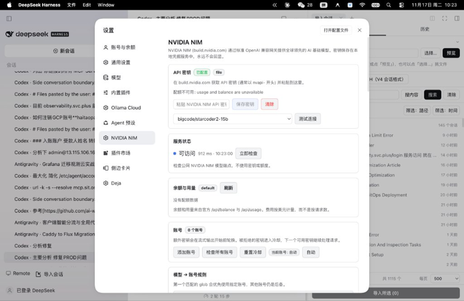

# 📦 @ai-workspace-lab/dsh-nvidia-cloud-provider

<div align="center">

<h3>NVIDIA NIM Cloud Provider for DeepSeek Harness</h3>

<p>
  <a href="https://github.com/ai-workspace-lab/dsh-nvidia-cloud-provider"></a>
  <a href="https://build.nvidia.com"></a>
  <a href="https://github.com/ai-workspace-lab/dsh-nvidia-cloud-provider/blob/main/LICENSE"></a>
</p>

</div>

---

NVIDIA NIM cloud provider plugin for [DeepSeek Harness](https://deepseek-harness.github.io/deepseek-harness/) (`dsh`).

It registers the **`nvidia-nim`** provider route, connecting DeepSeek Harness directly to [build.nvidia.com](https://build.nvidia.com) through an OpenAI-compatible gateway (`https://integrate.api.nvidia.com/v1`).

## Features

- **Coexists Independently**: Coexists seamlessly with Ollama Cloud and other providers without route, storage, or UI collisions.
- **Auto Model Discovery**: Automatically fetches and categorizes available NVIDIA NIM models from `integrate.api.nvidia.com/v1/models`.
- **OpenAI-Compatible Streaming**: Full support for tool calling, reasoning/thinking streams, and multi-modal image inputs.
- **Smart Rotation & Cooldown**: Multi-account pooling with automatic cooldown on 429 rate limits and sticky session support.
- **Zero-Restart Credential Management**: Update or rotate your `NVIDIA_API_KEY` dynamically in settings.

## Quick Start

### 1. Install

```bash
dsh plugin add @ai-workspace-lab/dsh-nvidia-cloud-provider
```

Or install from GitHub directly:

```bash
dsh plugin add github:ai-workspace-lab/dsh-nvidia-cloud-provider
```

### 2. Configure

Add to your `cordis.patch.yml`:

```yaml
- id: llm-nvidia-nim
  name: "@ai-workspace-lab/dsh-nvidia-cloud-provider"
  config:
    apiKeyEnv: NVIDIA_API_KEY # or paste directly in Settings → NVIDIA NIM
```

### 3. Usage

1. Open DeepSeek Harness **Settings → NVIDIA NIM**.
2. Paste your API key from [build.nvidia.com](https://build.nvidia.com) (starts with `nvapi-`).
3. Click **Save key** and **Test connection**.
4. Select any NIM model (e.g., `google/gemma-4-31b-it`, `mistralai/mistral-large-4-1t-a52b`) in the chat model picker.

## Visual Verification

NVIDIA NIM settings page in DeepSeek Harness Desktop (running alongside Ollama Cloud without collision):



## License

[MIT](LICENSE)
