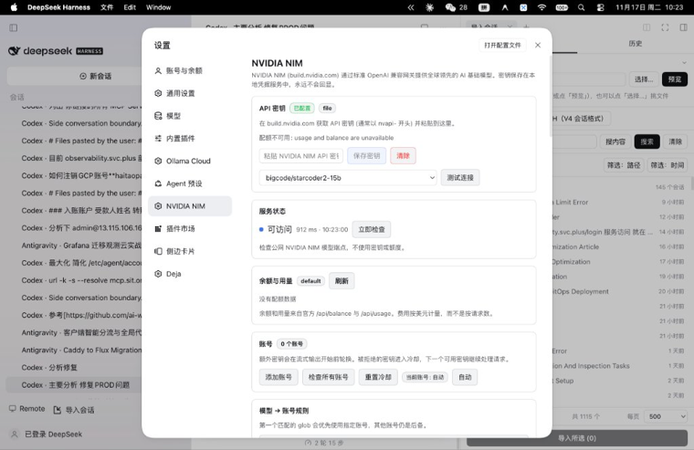

# 📦 @ai-workspace-lab/dsh-nvidia-cloud-provider

<div align="center">

<h3>面向 DeepSeek Harness 的 NVIDIA NIM 云端大模型提供商插件</h3>

<p>
  <a href="https://github.com/ai-workspace-lab/dsh-nvidia-cloud-provider"></a>
  <a href="https://build.nvidia.com"></a>
  <a href="https://github.com/ai-workspace-lab/dsh-nvidia-cloud-provider/blob/main/LICENSE"></a>
</p>

</div>

---

面向 [DeepSeek Harness](https://deepseek-harness.github.io/deepseek-harness/) (`dsh`) 的 **NVIDIA NIM** 云端模型提供商插件。

插件注册原生 LLM 路由 **`nvidia-nim`**，通过标准 OpenAI 兼容网关（`https://integrate.api.nvidia.com/v1`）无缝连接到 [build.nvidia.com](https://build.nvidia.com)，提供全球顶尖的开源与专有大模型云端推理能力。

## 特性亮点

- **独立并行共存**：与 Ollama Cloud 或其他提供商完全物理隔离（路由、存储、客户端模块 ID 均独立），互不冲突。
- **动态模型发现**：自动对接 `integrate.api.nvidia.com/v1/models`，智能过滤仅保留生成式对话模型，保障对话稳定。
- **OpenAI 兼容协议流式交互**：原生支持流式输出、深度思考（Thinking/Reasoning）、工具调用（Tool Calls）及多模态图像输入。
- **多账号轮换与智能冷却**：支持多 API 密钥配置池化管理，遭遇 429 速率限制时自动冷却并故障切换。
- **无重启凭据管理**：凭据由本地系统安全保存，随时在设置界面更新或轮换 `NVIDIA_API_KEY`，即刻生效。

## 快速上手

### 1. 安装插件

通过 npm 安装：

```bash
dsh plugin add @ai-workspace-lab/dsh-nvidia-cloud-provider
```

或者直接通过 GitHub 仓库安装：

```bash
dsh plugin add github:ai-workspace-lab/dsh-nvidia-cloud-provider
```

### 2. 基础配置

在您的 `cordis.patch.yml` 中添加插件启用项：

```yaml
- id: llm-nvidia-nim
  name: "@ai-workspace-lab/dsh-nvidia-cloud-provider"
  config:
    apiKeyEnv: NVIDIA_API_KEY # 或直接在 DSH 桌面端「设置 → NVIDIA NIM」中可视化配置
```

### 3. 使用说明

1. 打开 DeepSeek Harness **设置 → NVIDIA NIM**。
2. 粘贴在 [build.nvidia.com](https://build.nvidia.com) 领取的 API Key（格式为 `nvapi-...`）。
3. 点击 **保存密钥**，然后点击 **测试连接**。
4. 在对话输入框上方的模型切换面板中选择任意 NVIDIA NIM 模型（如 `google/gemma-4-31b-it`、`mistralai/mistral-large-4-1t-a52b` 等）即可开始对话！

## 界面预览

DeepSeek Harness 桌面端中的 NVIDIA NIM 设置面板（与 Ollama Cloud 完全隔离并存）：



## 开源许可证

[MIT](LICENSE)
